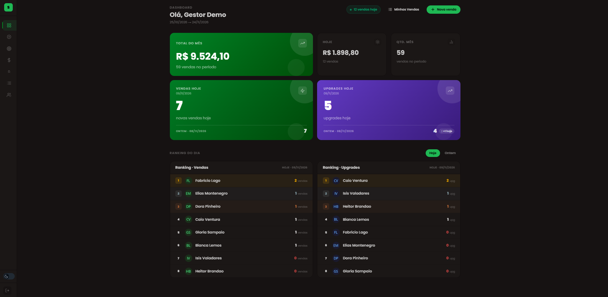

# Sales Commission CRM (demo)

CRM de vendas e comissão com login por papéis, metas e apuração por ciclo.
Versão demo com **dados 100% fictícios**, baseada em um sistema que construí
para uma equipe comercial.

## Funcionalidades
- Login por papéis: **admin**, **gestor** e **vendedor** (cada um vê só o que pode)
- Registro de vendas e acompanhamento de metas
- Comissão por faixas, calculada por ciclo de apuração (**dia 25 ao dia 24**)
- Dashboard com filtros por período e tipo
- Atualização em tempo real com Firestore
- API em Express (`functions`) protegida por chave de API

## Stack
React, Vite, Tailwind CSS, Firebase (Auth, Firestore, Hosting), Node.js/Express

## Como rodar
1. `npm install`
2. Crie um projeto no Firebase e copie `.env.example` para `.env.local`,
   preenchendo as variáveis `VITE_FIREBASE_*`
3. Publique as regras: `firebase deploy --only firestore:rules`
4. Popule os dados fictícios: `<comando do seed no package.json>`
5. `npm run dev`

## Contas de demonstração
Senha de todas: `Demo123!`

| Papel | E-mail |
| --- | --- |
| Admin | admin@exemplo.com |
| Gestor | gestor@exemplo.com |
| Vendedor | vendedor1@exemplo.com |

## Aprendizados
- **Segurança fica no servidor:** permissão só no front não protege nada.
  Migrei de listas de e-mails no código para um campo `role` + regras do Firestore.
- **Regras abertas são risco:** corrigi uma regra que permitia criar perfil com papel elevado.
- **Dados sensíveis:** anonimizei nomes, valores e configuração antes de publicar
  e criei um seed idempotente com dados fictícios.
- **Conferir o que a IA entrega:** usei IA como assistente, mas revisei, testei
  e corrigi (ela chegou a afirmar que o lint passava quando não passava).
- **Próximos passos:** testes automatizados da regra de comissão, consultas
  filtradas por ciclo (em vez de ler a coleção inteira) e TypeScript.
